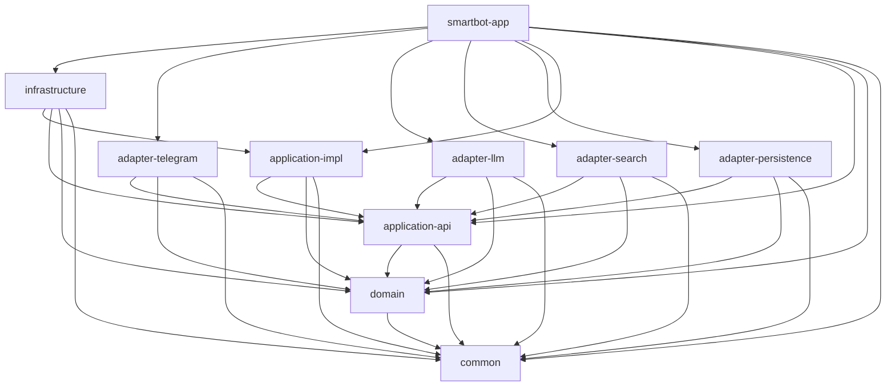
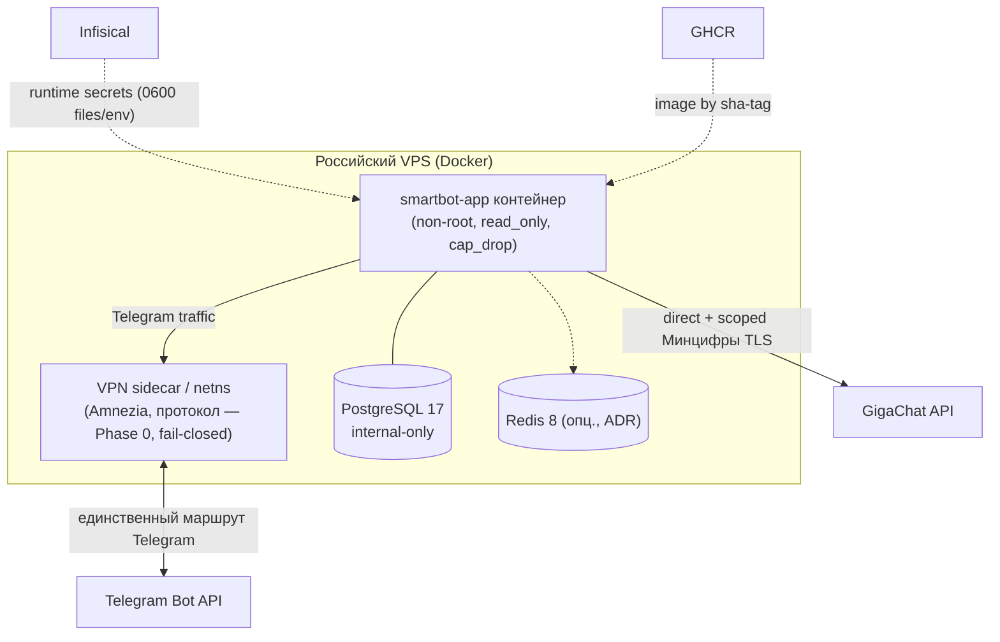
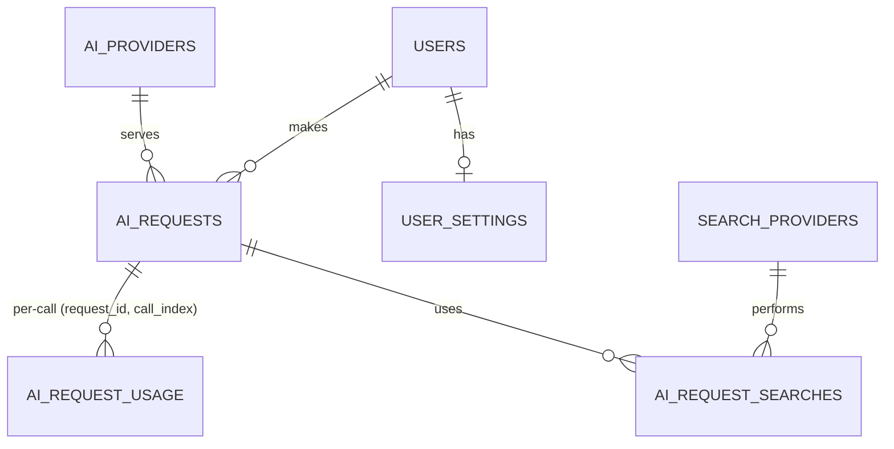

# Architecture Spine — SmartBot

## Design Paradigm

**Hexagonal Architecture (ports & adapters) внутри Modular Monolith.** Один
deployable (`smartbot-app`), 10 Maven-модулей. Ядро (domain + application)
не знает о фреймворках и внешних системах; адаптеры реализуют порты;
wiring — только в composition root.

| Слой | Пакет | Модуль |
| --- | --- | --- |
| Domain | `ru.smartbot.domain` | smartbot-domain |
| Ports / contracts | `ru.smartbot.application.api` | smartbot-application-api |
| Use cases | `ru.smartbot.application.impl` | smartbot-application-impl |
| Inbound adapter | `ru.smartbot.adapter.telegram` | smartbot-adapter-telegram |
| Outbound adapters | `ru.smartbot.adapter.{llm,search,persistence}` | соответствующие модули |
| Cross-cutting | `ru.smartbot.infrastructure` | smartbot-infrastructure |
| Composition root | `ru.smartbot.app` | smartbot-app |

## Invariants & Rules

### AD-1 — Границы модулей enforced двумя механизмами [ADOPTED]

- **Binds:** все модули, все stories
- **Prevents:** дрейф зависимостей; Spring/SDK в ядре (в т.ч. неиспользуемый в pom); common как свалка доменной семантики
- **Rule:** зависимости строго по матрице AD-2. Enforcement: (a) ArchUnit
  `ArchitectureBoundariesTest` (classpath-зависимости), (b) maven-enforcer
  `bannedDependencies` (pom-уровень: Spring/JPA/SDK запрещены в common, domain,
  application-api). Падение любого — блокирует merge. `smartbot-common` —
  только технические утилиты/типы без доменной семантики; доменные типы —
  только в domain.

### AD-2 — Полная матрица зависимостей [ADOPTED]

- **Binds:** все Maven-модули
- **Prevents:** циклы, обход портов, прямой вызов адаптера из ядра, «серые» рёбра
- **Rule:** разрешены только рёбра матрицы; новая зависимость между модулями
  требует изменения этого AD.



Стек-зависимости: application-impl — spring-context/tx; adapter-telegram/llm/search —
WebClient (webflux); adapter-persistence — JPA/Flyway/PostgreSQL; infrastructure —
Micrometer; app — web/actuator. Внешние SDK в ядре запрещены (AD-1).

### AD-3 — Единый владелец доменного состояния

- **Binds:** adapter-telegram, application-impl, adapter-persistence
- **Prevents:** два владельца сущности; мутация домена адаптером
- **Rule:** жизненный цикл `AiRequest` меняет **только** application-impl через
  порт репозитория; принцип распространяется на `User`/`UserSettings` (AD-17) и
  `AiRequestUsage` (AD-16). Адаптеры передают команды/события и DTO, не мутируют
  домен. `ai_requests.telegram_update_id` хранит id **callback-update**,
  создавшего запрос. Транспортная идемпотентность — отдельный ledger (AD-14).
  Переходы статусов — только по графу AD-15.

### AD-4 — Секреты вне кода, БД, логов и error-путей [ADOPTED]

- **Binds:** все модули, CI/CD, deployment
- **Prevents:** утечка bot token / GigaChat key / VPN-ключей, в т.ч. через exception messages, URL, метрики, build-кэш
- **Rule:** секреты — только Infisical / защищённые env/файлы (0600, вне репо и
  Docker context). Конфигурация провайдеров в БД — без секретов. Redaction
  покрывает message + stacktrace + MDC всех appender'ов, включая паттерн
  `bot\d+:[A-Za-z0-9_-]+` в URL; wire-логи HTTP-клиентов в prod — WARN;
  метрики не тегируются полным URI и PII. Сырые внешние тела/заголовки не
  пересекают порт (AD-20). `.dockerignore` + копирование только исходников в
  build-стадию; секреты не в `ARG`/`ENV` Dockerfile. Пользователю — только
  безопасные сообщения из каталога AD-20.

### AD-5 — Сетевое разделение и fail-closed VPN [ADOPTED]

- **Binds:** adapter-telegram, deployment, Phase 0
- **Prevents:** Telegram-трафик мимо VPN; GigaChat через VPN; VPN-логика в коде; тихий fallback на прямой маршрут
- **Rule:** маршрут Telegram — на сетевом уровне (sidecar/netns, вариант — ADR
  после Phase 0); приложение VPN-агностично. GigaChat/PostgreSQL/Infisical/search —
  напрямую. VPN-ключ — только файлом на хосте (`/etc/smartbot/vpn/`, 0600, ro-монт)
  или docker secret; запрещены env контейнера и запекание в образ. Fail-closed:
  при падении VPN — unhealthy + алерт, не fallback. Sidecar — минимум привилегий
  (`NET_ADMIN`, без `privileged`). Протокол Amnezia не предполагается до проверки;
  существующая VPN-инфраструктура не меняется без approval.

### AD-6 — LlmProvider порт и контракт GigaChat [ADOPTED]

- **Binds:** adapter-llm, application-api
- **Prevents:** привязка ядра к GigaChat; расхождение формы порта; хардкод моделей; сломанный TLS; два кэша токена
- **Rule:** ядро видит только порт `LlmProvider`. Минимальный контракт:
  синхронный `complete(LlmRequest): LlmResponse`; `LlmRequest` несёт model,
  prompt/messages, `maxOutputTokens` (единственный источник лимита — AD-18),
  optional tools; `LlmResponse` несёт text, toolCalls, finishReason, usage
  (per-call, **возвращается** ядру; адаптер ничего не персистит — AD-16).
  Streaming — **не в initial release** (Deferred). Function Calling — в контракте
  порта (нужен для Phase 5). Capability flags провайдера — в метаданных порта.
  GigaChat: base `https://api.giga.chat`, `POST /v1/chat/completions`; OAuth —
  уникальный `RqUID` UUID на каждый запрос (включая refresh); single-flight
  refresh с safety margin (AD-21); модели проверяются через API, проверенный
  список — в `ai_providers.config` (AD-24). TLS: верификация не отключается
  (`InsecureTrustManagerFactory`/trust-all запрещены, CI grep + review);
  корневой сертификат Минцифры — в **scoped truststore** только для
  GigaChat-клиента, fingerprint сверен с официальным и зафиксирован в docs;
  проверить оба endpoint'а (OAuth `ngw.devices.sberbank.ru:9443` и API).

### AD-7 — Контракт поиска и канонический SearchResult

- **Binds:** adapter-search, application-impl, domain
- **Prevents:** несогласованные формы результатов; потеря источников; лишние провайдеры; две схемы в jsonb
- **Rule:** режимы `NONE | NATIVE | EXTERNAL | AUTO`. `SearchResult` — тип в
  domain: `title: String`, `url: String` (нормализованный http(s), без
  tracking-параметров), `snippet: String` (cap configurable),
  `publicationDate: Instant?`, `sourceMetadata: Map<String,String>` (плоский).
  Нормализация — в adapter-search до возврата; валидация и дедупликация по url —
  в impl. В jsonb — только каноническая форма. Цитаты — единый нумерованный
  sources-блок, рендерит только impl (AD-19). Выбор провайдера в AUTO —
  детерминированное правило impl (приоритет/config), не эвристика адаптера;
  за запрос — не более одного необходимого провайдера. Function Calling —
  только allowlist инструментов (search); URL для поиска не берутся из
  текста пользователя/модели (SSRF-запрет, AD-25).

### AD-8 — Асинхронная генерация через inline-callback

- **Binds:** adapter-telegram, application-impl, application-api
- **Prevents:** блокировка inline-ответа; падения на истёкших callback; расхождение inbound-контрактов Phase 2/6
- **Rule:** inline_query → мгновенный лёгкий `InlineQueryResultArticle`
  (`is_personal=true`, `cache_time=0`) с кнопкой Generate Answer **на
  опубликованном inline-сообщении**. Корреляция — по AD-13. Callback →
  валидация → AiRequest → async generation → `editMessageText` через outbound-порт
  `InlineMessageEditor` (application-api, реализация adapter-telegram).
  `answerCallbackQuery` отправляется **немедленно** при валидном callback,
  до генерации. Callback без `inline_message_id` — валидационная ошибка
  (доменный код INVALID_CALLBACK), не нормальный путь. Истёкшие/невалидные
  callback — graceful, статус EXPIRED ставит impl (AD-15).

### AD-9 — Данные: UUID внутри, BIGINT Telegram, Flyway [ADOPTED]

- **Binds:** adapter-persistence, domain
- **Prevents:** смешение id; неконтролируемая схема; хранение контекста диалогов
- **Rule:** внутренние id — UUID; Telegram id — BIGINT. Схема — только Flyway
  (forward-only; destructive — отдельный approval); `ddl-auto=validate`.
  Контекст диалогов не хранится. История configurable (AD-26). Индексы/FK/unique —
  в миграциях. Формы, зафиксированные AD-14/15/16/19 (ledger, partial unique,
  lease, per-call usage, truncation), входят в первую миграцию Phase 3 —
  corrective-миграции запрещены политикой «фиксировать до первой миграции».

### AD-10 — Cost & abuse control: конфигурируемость [ADOPTED]

- **Binds:** infrastructure, application-impl, application-api
- **Prevents:** неограниченные расходы; хардкод коммерческих правил
- **Rule:** per-user rate limiting, квоты, global LLM budget, max output tokens,
  timeouts, duplicate protection — конфигурируемы (`smartbot.*`), дефолты
  консервативные. Точка enforcement и семантика учёта — AD-18. Порты лимитов —
  в application-api, реализация — infrastructure (ребро INFRA→API). Дефолт
  initial release — in-memory (single instance); Redis — только по обоснованию
  (ADR до внедрения, с auth и single-flight). Автоматическая регистрация — AD-17.

### AD-11 — Сборка, поставка, изоляция окружений [ADOPTED]

- **Binds:** CI/CD, Docker, deployment, все разработчики/агенты
- **Prevents:** дрейф окружений; конфликт двух poller'ов на token; невоспроизводимый деплой; секреты в workflow-логах
- **Rule:** локальная сборка — Docker (`make build/test/verify`). CI: feature/* →
  build+tests; develop → DEV; release → PROD; образы в GHCR. **Изоляция
  окружений (инвариант, не deferred): DEV и PROD — разные bot tokens (разные
  боты), разные БД, разные Infisical environments, Spring profiles `dev`/`prod`.**
  Один bot token = ровно один активный poller/webhook во всех окружениях (AD-23).
  Теги образов: `sha-<gitsha>` + branch-тег; **деплой только по sha-тегу/digest**,
  `latest` не используется для деплоя. Rollback = redeploy предыдущего
  известного sha-тега + та же verification. Деплой: inspect → plan → rollback →
  approval; секреты — environment-scoped (GitHub Environments с protection для
  prod), не repo-wide. Успех деплоя не заявляется без verification. Docker
  runtime: non-root, `read_only`, `cap_drop: ALL`, `no-new-privileges`, tmpfs /tmp,
  resource limits, healthcheck; JVM `-XX:+ExitOnOutOfMemoryError`.

### AD-12 — Документирование решений [ADOPTED]

- **Binds:** все фазы
- **Prevents:** неверифицированные предположения; потеря решений
- **Rule:** документация — русский, англ. термины сохраняются. Решения — ADR в
  `docs/decisions/`. Инфраструктурные факты — только после проверки; **чувствительные
  инфра-факты (IP, порты, SSH usernames, VPN endpoints) не попадают в коммитимые
  артефакты** (Phase 0 report — в защищённое хранилище, в Git — ссылка/обезличенная
  версия). Блокеры — в PROJECT_BOOTSTRAP.md. Диаграммы — Mermaid.

### AD-13 — Контракт корреляции inline_query → callback [NEW]

- **Binds:** application-api, application-impl, adapter-telegram, adapter-persistence
- **Prevents:** два формата callback_data; потеря query при рестарте; adapter-owned бизнес-корреляцию
- **Rule:** на `inline_query` application-impl создаёт персистентную запись
  корреляции — `AiRequest` в статусе CREATED с `query_text`, `telegram_user_id`,
  `result_id` (UUID внутри; наружу — короткий opaque token). `callback_data` —
  **только** opaque token фиксированного формата (≤64 байт); формат, генерация и
  валидация — в application-impl/api; adapter передаёт token непрозрачно, не
  парсит и не генерирует. Query между inline_query и callback хранится только
  в БД (TTL configurable), не в памяти адаптера. Контракт
  `HandleCallbackUseCase(token, inlineMessageId, principal)` фиксируется в
  application-api **до начала Phase 2**; mock-реализация использует тот же контракт.
  Сервер проверяет: запись существует, принадлежит `callback.from.id`, не истекла,
  статус допускает генерацию (защита от forged callback_data).

### AD-14 — Бизнес-идемпотентность и гранулярность генерации [NEW]

- **Binds:** adapter-telegram, application-impl, adapter-persistence
- **Prevents:** двойные платные генерации на одно сообщение; гонку editMessageText; неопределённость якоря update_id
- **Rule:** транспортная идемпотентность — ledger
  `processed_updates(telegram_update_id BIGINT PK, kind, processed_at)` для
  **всех** типов updates. Бизнес-ключ: **не более одного активного
  (CREATED/GENERATING) AiRequest на `inline_message_id`** — partial unique index
  в миграции + проверка в impl. Повторный callback по тому же
  `inline_message_id` идемпотентно возвращает существующий запрос (повторный
  edit — только retry того же результата, не новая генерация). Гранулярность —
  **на публикацию**: один inline_message_id = один AiRequest = один расход.
  Повторный inline_query (тот же текст, тот же пользователь, окно TTL)
  переиспользует запись корреляции, не плодит token'ы.

### AD-15 — AiRequest state machine, lease и recovery [NEW]

- **Binds:** domain, application-impl, application-api, adapter-persistence
- **Prevents:** гонку watchdog vs generation; зависшие GENERATING; перезапись терминальных статусов; неопределённость «доставка упала»
- **Rule:** граф переходов в domain (`AiRequestStatus`, enforced domain-методом):
  `CREATED → GENERATING | EXPIRED | FAILED`;
  `GENERATING → COMPLETED | FAILED | EXPIRED`; терминальные — immutable.
  Переход — атомарный CAS (`UPDATE … WHERE status = :expected` / optimistic lock);
  проигравший CAS не редактирует сообщение. EXPIRED ставит только impl:
  use case валидации callback (вызывается адаптером) или watchdog TTL.
  Ошибка доставки после успешной генерации = COMPLETED + отдельный
  `delivery_error_code` (генерация и доставка — разные оси; поля в схеме).
  Один AiRequest = один in-flight исполнитель: **lease/heartbeat** (поля в схеме,
  обновление исполнителем); recovery при старте: осиротевшие GENERATING с
  истёкшим lease → FAILED `RESTARTED`. Generation timeout, TTL, lease —
  configurable (`smartbot.*`), иерархия timeout — AD-18.

### AD-16 — Единый владелец usage, per-call гранулярность [NEW]

- **Binds:** adapter-llm, application-impl, infrastructure, adapter-persistence
- **Prevents:** двух писателей AiRequestUsage; UK-violation при multi-call function calling; расхождение latency/cost
- **Rule:** adapter-llm **возвращает** usage в `LlmResponse` (per-call) и ничего
  не персистит. Единственный писатель `AiRequestUsage` — application-impl.
  Гранулярность: **одна строка на LLM-call** (`request_id FK`, `call_index`,
  unique `(request_id, call_index)`; UK на request_id отсутствует). Агрегат по
  запросу вычисляется. `latency_ms` = длительность LLM-call (меряет adapter,
  передаёт в response); end-to-end latency — отдельная метрика impl.
  `estimated_cost` считает только impl по единой прайс-конфигурации
  (`smartbot.pricing.*`); infrastructure читает, не пишет. Budget
  резервируется/списывается по тем же per-call записям (AD-18).

### AD-17 — Единый владелец User, get-or-create semantics [NEW]

- **Binds:** application-impl, adapter-telegram, infrastructure, adapter-persistence
- **Prevents:** гонку первой регистрации; саморазблокировку blocked; регистрацию в адаптере
- **Rule:** User/UserSettings создаёт/обновляет только application-impl. Адаптер
  передаёт `TelegramPrincipal` (telegram_user_id, username?, first_name?,
  language_code?) в каждом use case. Impl — атомарный get-or-create
  (`INSERT … ON CONFLICT (telegram_user_id) DO UPDATE` только profile-полей и
  `last_seen_at`). Upsert **не трогает** `status` и `history_enabled`; blocked
  меняет только явный admin/use-case путь. Проверка blocked — до создания
  AiRequest и до списания квоты. Регистрация — на первом любом update,
  идемпотентно, в одной транзакции с проверкой лимита.

### AD-18 — Единая точка enforcement лимитов [NEW]

- **Binds:** application-impl, application-api, infrastructure, adapter-llm
- **Prevents:** двойной enforcement (AOP vs impl); расхождение учёта квот/бюджета; два источника max tokens; инверсию timeout
- **Rule:** все per-user проверки (blocked, rate limit, quota) и global budget
  reserve — **в application-impl**, в фиксированном порядке, до перевода
  AiRequest в GENERATING, через порты `RateLimitPort`, `QuotaPort`, `BudgetPort`
  (application-api; реализация — infrastructure). Infrastructure **не** оборачивает
  use cases AOP'ом. Отказ лимита = AiRequest FAILED с доменным кодом; attempt
  **не потребляет** квоту генерации, но учитывается в rate-limit окне. Budget:
  атомарный reserve до call → settle по per-call usage → release остатка;
  один владелец счёта — impl; каждый retry проходит budget-check.
  `max_output_tokens`: единственное значение — `LlmRequest.maxOutputTokens` =
  `min(smartbot.limits.max-output-tokens, provider.config.maxOutputTokens?)`;
  provider обязан передать его в API и не превышать; конкурирующего лимита в
  provider config нет. Иерархия timeout (enforced тестом):
  `request TTL > generation timeout > LLM call timeout (incl. retries) > HTTP timeout`.

### AD-19 — Бюджеты длины и единственный владелец форматирования [NEW]

- **Binds:** adapter-telegram, application-impl, adapter-search, application-api
- **Prevents:** двойную обрезку; потерю источников; parse_mode-конфликт; переполнение prompt; расхождение «в БД vs отправлено»
- **Rule:** бюджеты Telegram (4096 символов сообщения, лимиты query/callback_data) —
  знание adapter-telegram, экспортируется как константы/порт `MessageLimits`;
  impl использует их. Финальный текст для Telegram формирует **целиком impl**:
  обрезается тело, **sources-блок с оригинальными URL не обрезается никогда**
  (AD-7 приоритетнее полноты). Adapter отправляет as-is, не режет и не
  форматирует. `parse_mode` — **HTML** на весь проект; экранирование — в
  adapter-telegram по единому правилу. В БД: полный `result_text` +
  отправленная версия/флаг truncation. Query: валидация длины — adapter
  (отказ с доменным кодом, без обрезки); в БД и LLM уходит идентичный текст;
  дополнительный cap query (`smartbot.limits.max-query-length`) — до LLM.
  Snippet cap и prompt budget — configurable, владелец — impl (cap применяется
  до сборки prompt).

### AD-20 — Доменный каталог ошибок и безопасные exception'ы [NEW]

- **Binds:** domain, application-api, все адаптеры, application-impl
- **Prevents:** утечку внешних payload через getMessage() в Telegram/логи; три каталога кодов; fallthrough-рендеринг
- **Rule:** единый enum `ErrorCode` в domain: `VALIDATION, INVALID_CALLBACK,
  EXPIRED, BLOCKED, RATE_LIMITED, QUOTA_EXCEEDED, BUDGET_EXCEEDED, TIMEOUT,
  PROVIDER_UNAVAILABLE, AUTH, SEARCH_UNAVAILABLE, DELIVERY_FAILED,
  MESSAGE_TOO_LONG, RESTARTED, INTERNAL`. Доменные исключения несут только
  `ErrorCode` + типизированные безопасные параметры; сырые внешние
  тела/заголовки не пересекают порт (adapter логирует их сам с redaction).
  Рендеринг user-message — единственная таблица `ErrorCode → безопасный текст`
  в application-api/impl; adapter-telegram не содержит своего маппинга и
  никогда не использует `getMessage()` для пользователя. Тест-страж:
  user-facing пути не принимают String message из адаптера.

### AD-21 — Владение retry и single-flight [NEW]

- **Binds:** adapter-llm, adapter-telegram, application-impl, infrastructure
- **Prevents:** мультипликативные ретраи; дубль in-flight completion; refresh storm; stale token
- **Rule:** transport-retry (429/5xx/сетевые, backoff + jitter, max attempts,
  в пределах call timeout) — **только внутри адаптера** (llm: один `complete()`;
  telegram: edit/send). application-impl **не ретраит** LLM-call; бизнес-retry —
  только явный новый AiRequest по новому callback. Lease (AD-15) гарантирует
  одного in-flight исполнителя. Token refresh: single-flight на scope (один
  refresh в полёт, остальные ждут), configurable safety margin; кэш токена —
  один на приложение (in-process; Redis — только через ADR с атомарным
  single-flight). RqUID — новый UUID на каждый OAuth-запрос; retry completion
  нового RqUID не требует.

### AD-23 — Транспортный контракт Telegram и порт доставки [NEW]

- **Binds:** adapter-telegram, application-api, application-impl, deployment
- **Prevents:** потерю updates; два poller'а на token; отсутствие edit-порта; двойной retry edit; webhook без auth
- **Rule:** семантика — **at-least-once**: offset getUpdates подтверждается
  только после персистентной обработки (ledger AD-14); graceful shutdown
  дожидается in-flight или оставляет их recovery (AD-15). Один bot token =
  ровно один активный poller (или webhook) во всех окружениях (AD-11).
  Outbound-порт `InlineMessageEditor` (editMessageText по inline_message_id) —
  в application-api, реализация adapter-telegram. Transport-retry (429
  retry_after, сетевые) — внутри адаптера; «message is not modified» = успех;
  «message not found»/истёкшее → доменный код EXPIRED/DELIVERY_FAILED, статус
  доставки решает impl (AD-15). Webhook (если выбран ADR-0002): обязательная
  проверка `X-Telegram-Bot-Api-Secret-Token` (constant-time compare), HTTPS,
  IP allowlist Telegram на proxy, путь — случайный slug (**не** `/bot<TOKEN>/…`);
  при переключении polling↔webhook — явный deleteWebhook/setWebhook в runbook.
  При Long Polling webhook-endpoint не поднимается; offset персистится.

### AD-24 — Иерархия конфигурации: user → provider → global [NEW]

- **Binds:** application-impl, adapter-persistence, adapter-llm, adapter-search
- **Prevents:** два источника истины search_mode/model; игнорирование user settings; INTERNAL при disabled provider
- **Rule:** эффективная конфигурация запроса вычисляется **только в impl** по
  приоритету: `UserSettings (если задано) → AiProvider/SearchProvider config (БД)
  → smartbot.* defaults (env)`. Адаптеры получают эффективные значения в
  запросе и не читают user_settings/global config сами. Проверенный список
  моделей — в `ai_providers.config` (обновляется явным use case/job после
  верификации через API); `default_model` обязан входить в список (тест).
  Disabled provider → FAILED `PROVIDER_UNAVAILABLE`, без INTERNAL и без
  молчаливого fallback на другой provider.

### AD-25 — Abuse и prompt-injection контроли публичного бота [NEW]

- **Binds:** application-impl, adapter-llm, adapter-search, infrastructure
- **Prevents:** indirect injection через search-сниппеты; SSRF; раскрытие системного промпта/конфига; спам-публикации
- **Rule:** системный промпт: пользовательский текст и search-сниппеты —
  **данные, не инструкции**; сниппеты оборачиваются разделителями с явным
  запретом выполнять инструкции из блока. Function Calling — только allowlist
  (search); никаких инструментов, выполняющих код/запросы по URL из ответа
  модели; целевые URL внутренних запросов не управляются пользователем/моделью.
  Бот не раскрывает системный промпт, конфигурацию, provider config, внутренние
  id. Модерация: фильтры GigaChat + выходные эвристики; per-user blocklist
  (AD-17), метрики abuse-срабатываний + алерт на аномальный рост регистраций.
  Тесты: WireMock-сценарии indirect injection; проверка отсутствия секретов и
  системного промпта в ответах.

### AD-26 — Приватность и минимизация данных [NEW]

- **Binds:** adapter-persistence, application-impl, domain
- **Prevents:** избыточный сбор PII; вечное хранение текстов запросов; soft-delete без очистки
- **Rule:** data minimization: `telegram_user_id` обязателен; username/имя —
  опционально, с обоснованием в docs/database. `history_enabled` дефолт —
  **off** (хранятся метаданные без текста query, если включено — текст с TTL).
  Retention TTL configurable (дефолт 30 дней), автоочистка scheduled job.
  Пользовательские команды `/privacy` и `/delete_me` (реальное удаление истории
  и deregistration) — контракт Phase 3. PII (query text, username) не логируется
  на INFO. Privacy policy до публичного запуска; юридическая оценка 152-ФЗ —
  gate PROD-запуска (Phase 7, не блокирует код).

## Consistency Conventions

| Concern | Convention |
| --- | --- |
| Naming | модули `smartbot-*`; пакеты `ru.smartbot.<layer>`; порты — интерфейсы в api (`LlmProvider`, `SearchProvider`, `InlineMessageEditor`, `RateLimitPort`, `QuotaPort`, `BudgetPort`, `MessageLimits`); адаптеры `<Tech><Port>`; use cases `<Action>UseCase` |
| IDs & dates | UUID внутри, BIGINT Telegram; `timestamptz` / `Instant` (UTC) |
| Errors | единый enum `ErrorCode` (AD-20); таблица ErrorCode→текст одна; наружу только безопасные сообщения |
| Config | `@ConfigurationProperties` prefix `smartbot.*`; иерархия user→provider→global (AD-24); секреты — env/Infisical |
| Telegram text | `parse_mode=HTML`, экранирование в adapter-telegram; финальный текст собирает impl (AD-19) |
| Logging | SLF4J; redaction message+stacktrace+MDC (AD-4); wire-логи prod WARN; PII не на INFO |
| Tests | unit — ядро без Spring; адаптеры — WireMock; persistence — Testcontainers; границы — ArchUnit + enforcer; IT — `*IT.java`; concurrency-тесты budget/регистрации; тесты forged callback и дублей |
| Миграции | `V<n>__<desc>.sql`; формы AD-14/15/16/19 — в первой миграции Phase 3 |

## Stack

| Name | Version |
| --- | --- |
| Java (Temurin) | 21 |
| Spring Boot | 4.2.0 (GA; baseline Java 17+) |
| Spring Framework | 7.1.x (managed) |
| Maven | 3.9 (maven:3.9-eclipse-temurin-21) |
| PostgreSQL | 17-alpine |
| Flyway | managed by Boot BOM |
| Redis (опционально, ADR-gate) | 8-alpine |
| JUnit Jupiter | 6.1.3 (managed; ArchUnit 1.5.1 совместим — проверено сборкой) |
| ArchUnit | 1.5.1 |
| WireMock | 3.13.2 (stable; 4.x beta не используется) |
| Testcontainers | 2.0.5 (managed; артефакты `testcontainers-*`) |
| Micrometer + Prometheus registry | managed by Boot BOM |
| Maven plugins | compiler 3.16.0, surefire/failsafe 3.6.1, enforcer 3.7.0 |
| Docker / Compose | 29.x / v2 |
| CI/CD | GitHub Actions → GHCR |
| Secrets | Infisical |

Версии проверены по repo1.maven.org, spring.io, Docker Hub 2026-11-20/21.
GigaChat `api.giga.chat` подтверждён живым probe (маршрут `/v1/chat/completions`
существует; есть `/v2` вариант для parallel tool calls — информационно).

## Structural Seed

```text
botCommand/
  pom.xml                     # parent, dependencyManagement, enforcer (bannedDependencies)
  smartbot-common/            # чистая Java, без доменной семантики
  smartbot-domain/            # ядро: entities, AiRequestStatus, ErrorCode, SearchResult
  smartbot-application-api/   # порты + контракты use cases
  smartbot-application-impl/  # use cases, владелец состояния, лимиты, форматирование
  smartbot-adapter-telegram/  # inline mode, polling/webhook, MessageLimits, HTML escape
  smartbot-adapter-llm/       # GigaChatProvider, OAuth single-flight, scoped truststore
  smartbot-adapter-search/    # SearchProvider, нормализация
  smartbot-adapter-persistence/ # JPA + Flyway (db/migration)
  smartbot-infrastructure/    # реализации портов лимитов, метрики, redaction
  smartbot-app/               # main, application.yml, profiles dev/prod, ArchUnit
  docs/                       # architecture, database, api, decisions, runbooks
  _bmad-output/               # BMAD artifacts (инфра-факты не коммитить, AD-12)
  Dockerfile, .dockerignore, docker-compose*.yml, Makefile, .github/workflows/
```

### Deployment & network topology (целевая, уточняется Phase 0)



Изоляция DEV/PROD — инвариант AD-11 (разные bot tokens/БД/Infisical
environments/profiles); топология (один VPS или разные) — Deferred.
Actuator — только loopback/internal network, не публичный порт.

### Core entities (relationships only; атрибуты-инварианты — в AD)



Схемные инварианты (в первой миграции Phase 3): `processed_updates` ledger
(AD-14); partial unique «один активный AiRequest на inline_message_id» (AD-14);
lease/heartbeat + `delivery_error_code` (AD-15); usage per-call без UK на
request_id (AD-16); полный `result_text` + truncation-поля (AD-19);
`users.telegram_user_id` unique (AD-17).

## Capability → Architecture Map

| Capability (initSpec / PRD) | Lives in | Governed by |
| --- | --- | --- |
| Inline Mode, updates, callbacks (Phase 2; FR1–7, 22–23) | adapter-telegram | AD-8, AD-13, AD-14, AD-19, AD-23 |
| User registration, lifecycle (Phase 3; FR15, 18–20) | application-impl + adapter-persistence | AD-3, AD-9, AD-14, AD-15, AD-17, AD-26 |
| GigaChat OAuth/completions (Phase 4; FR8–11, 25) | adapter-llm | AD-6, AD-16, AD-21, AD-24 |
| Search NONE/NATIVE/EXTERNAL/AUTO (Phase 5; FR12–14) | adapter-search | AD-7, AD-19, AD-24, AD-25 |
| Async generation, message update (Phase 6; FR5–7) | application-impl + adapter-telegram | AD-8, AD-13, AD-15, AD-18, AD-21, AD-23 |
| Rate limits, quotas, budget, monitoring (Phase 7; FR16–17, 24) | infrastructure + impl | AD-10, AD-16, AD-17, AD-18, AD-20, AD-25 |
| VPN routing, connectivity (Phase 0; NFR2–4) | deployment / network layer | AD-5, AD-6, AD-11, AD-12 |
| CI/CD, deploy (Phase 7; NFR7, 14) | .github/workflows, Docker | AD-11, AD-4 |

## Deferred

| Решение | Почему может ждать |
| --- | --- |
| Вариант VPN-маршрутизации (sidecar / netns / host) | Phase 0: фактический протокол и тесты канала; инварианты AD-5 уже binds |
| Long Polling vs Webhook (финально) | ADR-0002 proposed; после проверки канала; контракт обоих вариантов уже AD-23 |
| GigaChat SDK vs кастомный REST | оценка SDK в Phase 4; контракт порта AD-6 не зависит от выбора |
| Внешний search-провайдер | Phase F; абстракция и форма зафиксированы AD-7 |
| Redis (rate limit / token cache) | ADR-gate до внедрения; дефолт in-memory (AD-10/21); при внедрении — auth + single-flight |
| Async executor: in-process vs брокер | in-process + lease/recovery (AD-15) безопасен при деплое; брокер — при масштабировании, инварианты сохранятся |
| Streaming LLM | не в initial release; порт AD-6 расширяется capability-флагом без слома контракта |
| DEV/PROD топология (один VPS или разные) | Phase B; изоляция окружений уже инвариант AD-11 |
| Infisical delivery (agent/CLI/env) | ADR до Phase 2 (bot token); требования AD-4/11 binds; bootstrap identity — защищённый файл на хосте |
| Prometheus/Grafana стек | Phase 7; actuator/micrometer уже в скелете |
| chosen_inline_result analytics | out of scope initial release (FR21 optional); после Phase 7 |
| Backup/retention БД, digest-pinning образов | runbook/Phase 7; контракт тегов AD-11 уже binds |
| Юридическая оценка 152-ФЗ | gate PROD-запуска (AD-26), не блокирует код |

## Open Questions

1. Протокол и endpoint Amnezia VPN; доступность с целевого VPS (Phase C).
2. Ресурсы и ОС VPS, существующий Docker (Phase B).
3. Scope аккаунта GigaChat и доступные модели (Phase E).
4. Username PROD-бота и подтверждение Inline Mode (Phase D).
5. **DEV-бот: отдельный token/username** (требуется инвариантом AD-11).
6. Нужен ли inline feedback configuration?
7. Видимость GitHub-репозитория (public/private) — влияет на коммит BMAD-артефактов (AD-12).
