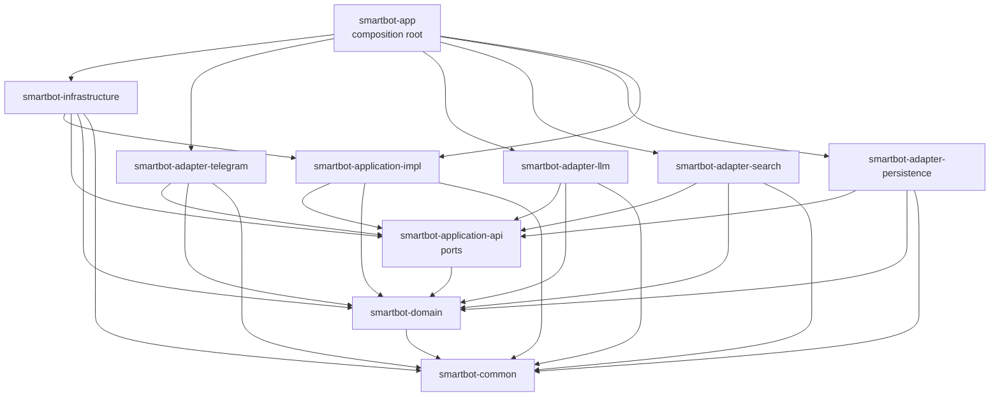
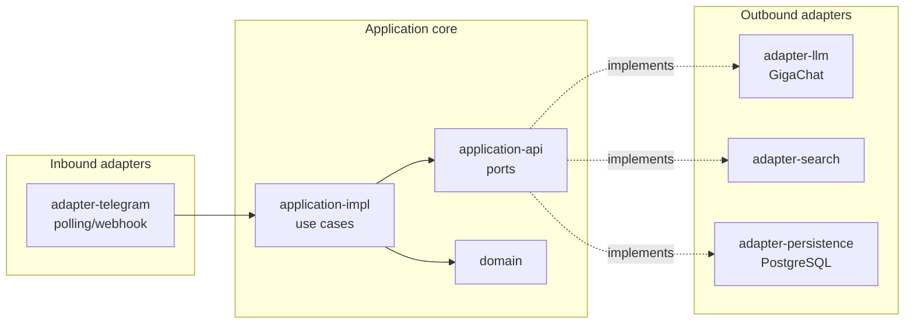

# Components — SmartBot (Modular Monolith, Hexagonal Architecture)

> Статус: Phase 1 skeleton. Контракты портов уточняются в BMAD Architecture Document.

## Модули и зависимости

## Правила границ (enforced: ArchUnit)

| Модуль | Разрешено | Запрещено |
|---|---|---|
| `smartbot-common` | JDK | всё остальное |
| `smartbot-domain` | common, JDK | Spring, JPA, SDK, адаптеры |
| `smartbot-application-api` | domain, common, JDK | Spring, реализации адаптеров |
| `smartbot-application-impl` | api, domain, common, spring-context/tx | Spring Web/Boot, адаптеры |
| `smartbot-adapter-*` | api, domain, common, свой стек (WebClient / JPA) | другие адаптеры, application-impl, app |
| `smartbot-infrastructure` | api, impl, domain, common, Micrometer | адаптеры |
| `smartbot-app` | все модули | — (единственный composition root) |

Тест: `smartbot-app/src/test/java/ru/smartbot/app/architecture/ArchitectureBoundariesTest.java`.

## Порты (application-api)

| Порт | Направление | Реализация | Фаза |
|---|---|---|---|
| `LlmProvider` | outbound | `GigaChatProvider` (adapter-llm) | 4 |
| `SearchProvider` | outbound | внешний провайдер (adapter-search), режимы NONE/NATIVE/EXTERNAL/AUTO | 5 |
| `InlineMessageEditor` | outbound | adapter-telegram (editMessageText) | 2/6 |
| `RateLimitPort`, `QuotaPort`, `BudgetPort` | outbound | infrastructure; вызываются только из impl (AD-18) | 3/7 |
| `MessageLimits` | константы/порт | adapter-telegram (бюджеты длины, AD-19) | 2 |
| Репозитории (User, AiRequest, ProcessedUpdate, …) | outbound | adapter-persistence (JPA) | 3 |
| Use cases (HandleInlineQuery, HandleCallback, GenerateAnswer, …) | inbound | application-impl; вызывает adapter-telegram | 2–3, 6 |

Контракты портов и ErrorCode catalog: [docs/api/contracts.md](../api/contracts.md)
(зафиксированы Architecture Spine AD-6, AD-13…AD-24).

## Enforcement границ

1. **ArchUnit** (`ArchitectureBoundariesTest`, smartbot-app) — classpath-зависимости.
2. **maven-enforcer bannedDependencies** (common/domain/application-api) —
   pom-уровень: Spring/JPA/Jackson/Reactor запрещены в ядре (AD-1).

## Hexagonal view

