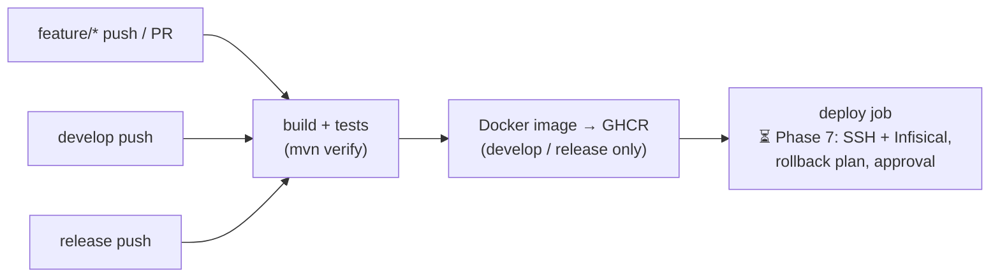

# Deployment — SmartBot

> Статус: шаблон Phase 1. Финальная схема — после Phase 0 assessment и
> утверждения deployment plan (initSpec.md §13: inspect → plan → rollback → approval).

## Окружения

| Окружение | Ветка | Назначение |
|---|---|---|
| DEV | `develop` | интеграционная проверка на VPS |
| PROD | `release` | публичный бот |

## Pipeline (GitHub Actions)

- Образ: `ghcr.io/dmitriiderendyaev/smartbot` (теги: branch, sha-*, latest для release).
- Deploy jobs **сознательно не реализованы** до Phase 0/7: неизвестны VPS,
  VPN-маршрут и схема доставки секретов. Запрещено выдумывать инфраструктуру.

## Runtime на VPS (предварительно)

- Docker Compose: `app` + `postgres` (+ `redis` profile при обосновании).
- Секреты: Infisical → env-переменные контейнера (механизм уточняется в Phase 7).
- Telegram-трафик: VPN-маршрут по ADR (см. network-routing.md).
- GigaChat TLS: корневой сертификат Минцифры в Java truststore образа/хоста.
- Monitoring: actuator `/actuator/health`, `/actuator/prometheus`;
  Prometheus/Grafana — когда обосновано (Phase 7).

## Rollback (заготовка)

1. Предыдущий образ по sha-тегу в GHCR.
2. `docker compose` с pinned image tag → redeploy предыдущей версии.
3. Flyway migrations: только forward-compatible; destructive changes — отдельный approval.

## Открытые вопросы

- [ ] VPS: ресурсы, ОС, существующий Docker (Phase B)
- [ ] VPN-маршрут: вариант A/B/C/D (Phase C, ADR)
- [ ] DEV и PROD на одном VPS или разных? (изоляция — уже инвариант, см. ниже)
- [ ] Infisical: self-hosted или cloud, способ доставки (agent/CLI/CSI)?

## Уточнено Architecture Spine (binding)

- **AD-11 изоляция окружений (инвариант):** DEV и PROD — **разные bot tokens
  (разные боты)**, разные БД, разные Infisical environments, Spring profiles
  `dev`/`prod`. Один bot token = ровно один активный poller/webhook во всех
  окружениях (иначе 409 Conflict и потеря updates).
- **AD-11 tagging/rollback:** деплой только по `sha-<gitsha>` тегу/digest;
  `latest` не используется для деплоя; rollback = redeploy предыдущего
  известного sha-тега + та же verification.
- **AD-11 hardening:** non-root, `read_only`, `cap_drop: ALL`,
  `no-new-privileges`, tmpfs /tmp, mem_limit, healthcheck (management-port
  loopback), JVM `ExitOnOutOfMemoryError` — уже в compose/Dockerfile.
- **AD-4/SEC-02:** actuator — только `127.0.0.1:9090` внутри контейнера;
  публичных inbound-портов при Long Polling нет; app-порт compose —
  `127.0.0.1:8080`.
- **SEC-10:** Infisical delivery — ADR до Phase 2 (bot token нужен уже там);
  минимум: CLI/agent рендерит секреты в `/etc/smartbot/secrets/` (0600),
  compose `env_file` оттуда; bootstrap identity — единственный защищённый
  файл на хосте; GitHub Environments `dev`/`prod` с required reviewers для prod.
- **SEC-11:** юридическая оценка 152-ФЗ + privacy policy — gate PROD-запуска.
