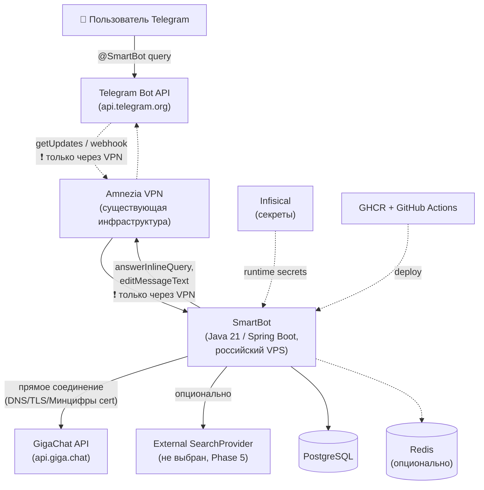

# System Context — SmartBot

> Статус: черновик Phase 1. Уточняется после Phase 0 (infrastructure assessment).

## Контекстная диаграмма

## Ключевые потоки

1. **Inline query**: пользователь набирает `@SmartBot <запрос>` в любом чате →
   Telegram присылает `inline_query` → SmartBot возвращает
   `InlineQueryResultArticle` (лёгкий результат с кнопкой **Generate Answer**).
2. **Генерация**: пользователь выбирает результат → `chosen_inline_result` /
   `callback_query` → асинхронная генерация (search → GigaChat) →
   `editMessageText` обновляет опубликованное inline-сообщение.
3. Контекст диалога **не используется**: каждый запрос независим.

## Внешние системы и ограничения

| Система | Направление | Сетевой маршрут | Статус проверки |
|---|---|---|---|
| Telegram Bot API | in/out | **только через Amnezia VPN** (прямой доступ с РФ VPS заблокирован) | ⏳ Phase 0 |
| GigaChat API | out | напрямую с РФ VPS | ⏳ Phase 0 (DNS, TLS, root cert Минцифры) |
| External Search | out | не определён (вероятно напрямую) | ⏳ Phase 5 |
| PostgreSQL | local | docker network / localhost | ✅ локально |
| Infisical | out | напрямую | ⏳ Phase 7 |

## Акторы

- **Пользователь Telegram** — публичный доступ, автоматическая регистрация при
  первом обращении, per-user rate limits и квоты.
- **Оператор (владелец)** — деплой, мониторинг, управление лимитами и бюджетом LLM.
