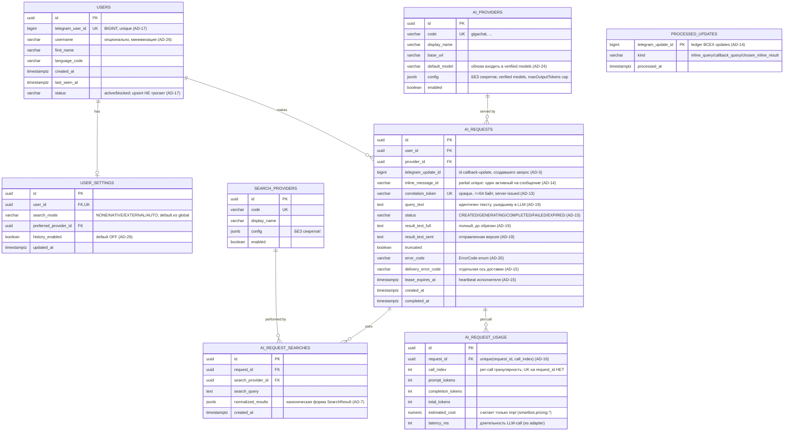

# ER Diagram — SmartBot

> Статус: зафиксировано Architecture Spine (AD-9, AD-14…AD-19, AD-26).
> Формы ниже входят в **первую миграцию Phase 3** (corrective-миграции запрещены).
> UUID — внутренние идентификаторы; BIGINT — Telegram ID. Контекст диалогов не хранится.

## Индексы и constraints (обязательны в миграции)

- `users.telegram_user_id` — unique (AD-17).
- `ai_requests.correlation_token` — unique (AD-13).
- **Partial unique**: один активный (CREATED/GENERATING) AiRequest на
  `inline_message_id` (AD-14):
  `CREATE UNIQUE INDEX … ON ai_requests (inline_message_id) WHERE status IN ('CREATED','GENERATING') AND inline_message_id IS NOT NULL`.
- `ai_request_usage (request_id, call_index)` — unique (AD-16).
- `ai_requests.user_id + created_at`, FK-индексы, `lease_expires_at` (recovery sweep).
- `processed_updates.telegram_update_id` — PK (AD-14).

## Принципы

- Секреты провайдеров **не в БД**: конфигурация отдельно, credentials в Infisical.
- История: `history_enabled` default **off**; при включении — retention TTL
  (дефолт 30 дней) + автоочистка; `/delete_me` — реальное удаление (AD-26).
- Статусы меняет только application-impl, атомарный CAS (AD-15).
